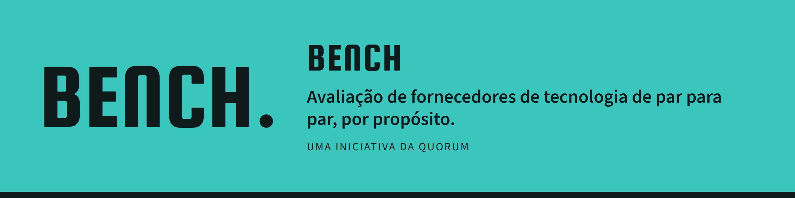
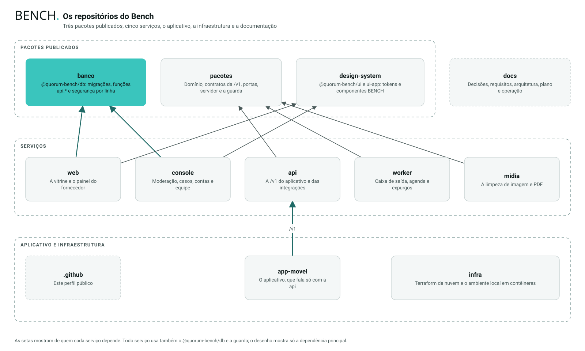

  

  
  

  <a href="#os-repositórios">Os repositórios</a> ·
  <a href="#como-trabalhamos">Como trabalhamos</a> ·
  <a href="#segurança-e-contato">Segurança e contato</a> ·
  <a href="#para-quem-é-da-organização">Para quem é da organização</a>

**O Bench é onde quem compra tecnologia numa grande empresa consulta a experiência de quem já usou o fornecedor, para o mesmo propósito.** A leitura dos pares aparece em três partes, Fit, Neutro e Unfit, com o número de avaliações ao lado. Nunca nota única, estrela ou ranking, e nenhum plano de fornecedor compra nota, posição ou destaque.

Duas regras governam cada linha de código desta organização:

> **Nada identifica quem pesquisa.** O fornecedor só sabe quem é o comprador quando o comprador pede contato.
>
> **Um grupo pequeno não aparece.** A leitura de um grupo só é mostrada com pessoas suficientes de empresas diferentes; abaixo disso, a célula fica guardada.

<picture>
  <source media="(prefers-color-scheme: dark)" srcset="assets/mapa.escuro.svg">
  
</picture>

## Os repositórios

> [!NOTE]
> Os repositórios abaixo são privados durante o pré-lançamento. Os links abrem para quem é membro da organização.

| Repositório | O que é | Documentação |
| --- | --- | --- |
| [web](https://github.com/quorum-bench/web) | A vitrine de quem compra, a avaliação em sete passos e o painel de quem fornece | completa |
| [console](https://github.com/quorum-bench/console) | O console da equipe: moderação, casos, contas, equipe e comercial | completa |
| [api](https://github.com/quorum-bench/api) | A API `/v1` que o aplicativo e as integrações usam | completa |
| [worker](https://github.com/quorum-bench/worker) | A caixa de saída, a agenda e os expurgos | completa |
| [midia](https://github.com/quorum-bench/midia) | A limpeza de imagem e PDF antes de qualquer arquivo ir ao ar | completa |
| [banco](https://github.com/quorum-bench/banco) | As migrações do PostgreSQL, as funções `api.*` e a segurança por linha | completa |
| [pacotes](https://github.com/quorum-bench/pacotes) | O domínio, os contratos da `/v1`, as portas e a guarda do código | completa |
| [design-system](https://github.com/quorum-bench/design-system) | Os tokens, os componentes e a marca BENCH | completa |
| [app-movel](https://github.com/quorum-bench/app-movel) | O aplicativo, que fala só com a `api` | completa |
| [infra](https://github.com/quorum-bench/infra) | A infraestrutura como código e o ambiente local em contêineres | completa |
| [docs](https://github.com/quorum-bench/docs) | As decisões, os requisitos, a arquitetura, o plano e a operação | completa |

"Completa" quer dizer: README com diagramas e telas reais, guias de começar, arquitetura, referência, operação, testes e solução de problemas, e conferências que reprovam link quebrado e tabela desatualizada.
## Como trabalhamos

| Regra | Quem a executa |
| --- | --- |
| Toda mudança entra por pull request, com a saída real dos testes colada | O modelo de PR de cada repositório |
| A regra de negócio mora no banco, numa função com teste; o serviço só chama | Os testes pgTAP do `banco` e o papel de banco de cada serviço, que só executa o que o código dele chama |
| Uma decisão só vale quando está registrada, com data e situação | Os ADRs do `docs` |
| Dado de pessoa nunca entra em teste, semente, tela ou log | A semente fictícia, que recusa rodar fora do ambiente local |
| Segredo nunca entra no repositório | O gitleaks antes de cada envio |
| Texto e código seguem a mesma escrita e a mesma marca | A guarda do código, que roda no `verificar` de cada repositório |
| A publicação em produção é sempre aprovada por uma pessoa | O fluxo de publicação da `infra` |

## Segurança e contato

Uma falha de segurança vai pelo canal privado descrito no [SECURITY.md](https://github.com/quorum-bench/.github/blob/main/SECURITY.md), nunca por issue aberta. Dúvidas e pedidos seguem o [SUPPORT.md](https://github.com/quorum-bench/.github/blob/main/SUPPORT.md). Quem contribui segue o [CONTRIBUTING.md](https://github.com/quorum-bench/.github/blob/main/CONTRIBUTING.md) e o [código de conduta](https://github.com/quorum-bench/.github/blob/main/CODE_OF_CONDUCT.md).

## Para quem é da organização

Quem é membro vê, nesta mesma página, o perfil interno: as telas do produto, como subir o ambiente local, as contas de teste e o estado de cada repositório.

Uma iniciativa da QUORUM.
